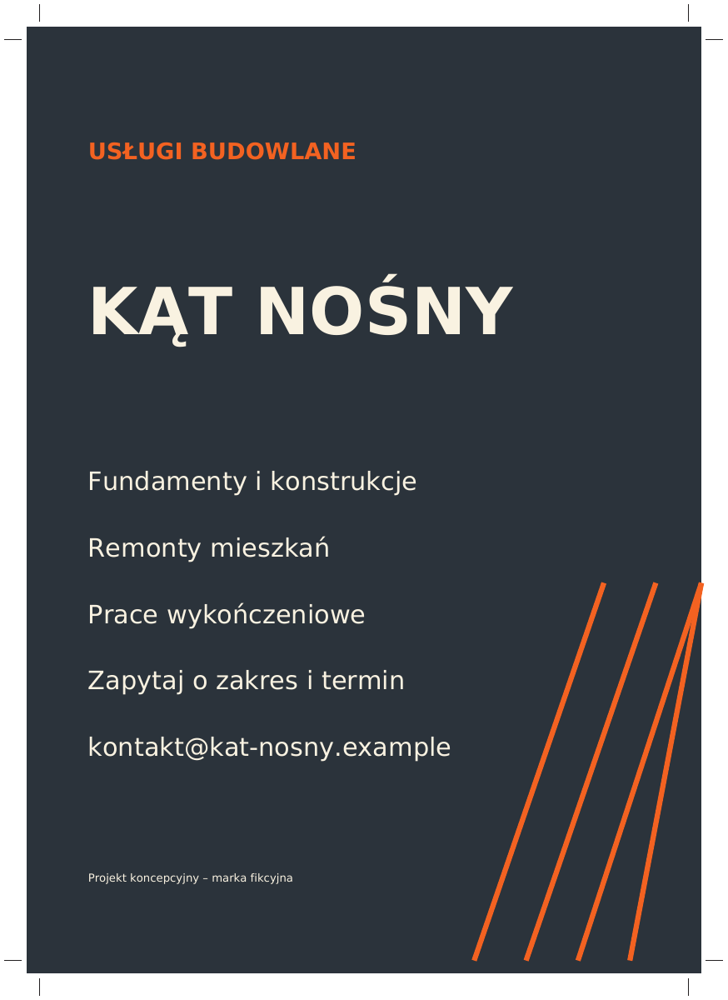

# Kąt Nośny · Pora Talerza

Projekt koncepcyjny – marka fikcyjna

Wizytówka dwustronna, roll-up i ulotka dla fikcyjnej firmy budowlanej oraz składane menu dla fikcyjnej restauracji.

## Overview

A vector print portfolio for business stationery, display banners, leaflets and restaurant menus. The two fictional brands use separate palettes and content.

## Files

- `exports/` contains six CMYK vector PDFs and six corresponding PNG proofs.
- `source/build.py` is the editable layout and export source.
- `index.html` is the preview gallery with CSS mockups.

## Specifications and editing

Business card 90 × 50 mm, roll-up 850 × 2000 mm, A5 leaflet 148 × 210 mm, and two A4 landscape menu spreads 297 × 210 mm. Fold the menu at 148.5 mm. Each PDF has a TrimBox, 3 mm bleed, and crop marks. The roll-up is supplied at full size. Confirm the vendor's hardware allowance and ICC requirements before production.

Edit the text, layout values and CMYK swatches in `source/build.py`, install ReportLab and DejaVu fonts, then run `python source/build.py`. Poppler generates the PNG proofs from the same PDFs. No photos are used.

## Technology

ReportLab, Python, vector PDF, Poppler, HTML and CSS.
